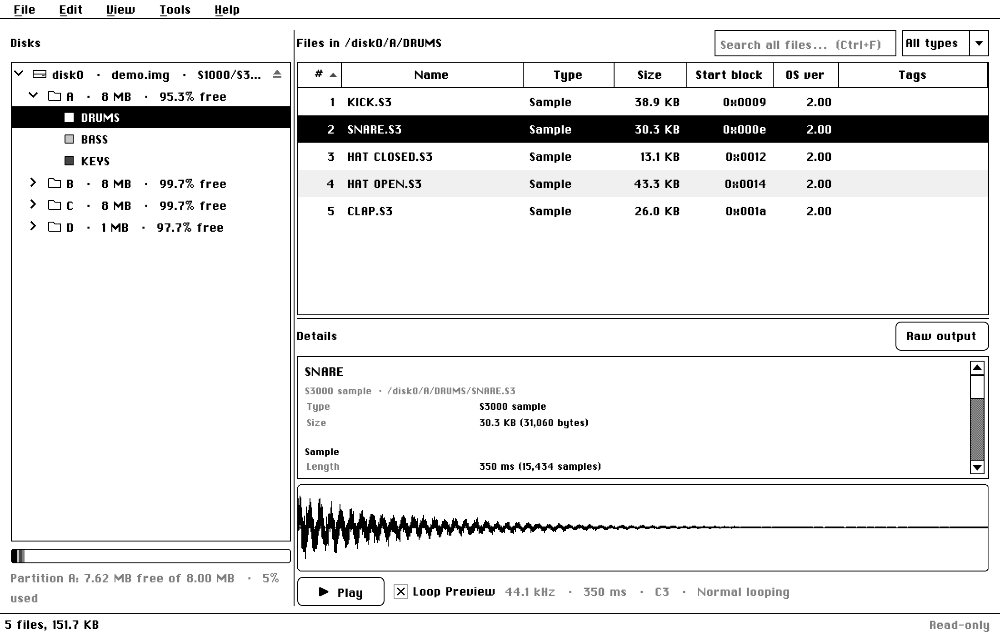
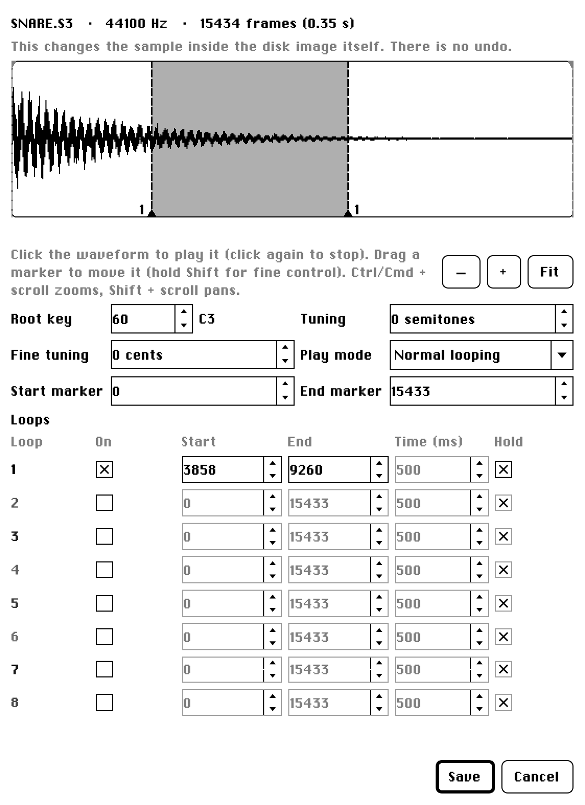

# akaiutil-gui

A cross-platform Qt GUI for [akaiutil](https://sourceforge.net/projects/akaiutil/) (Klaus Michael Indlekofer's tool for Akai S900/S1000/S3000 disk images).

**Need help? Read the [user manual](src/akaiutil_gui/ui/help/manual.md).**

  <picture>
    <source media="(prefers-color-scheme: dark)" srcset="src/akaiutil_gui/ui/help/screenshots/main-window-dark.png">
    
  </picture>

**Status: early.** Disk images open read-only by default. *Please* make backups of any important data; there is no undo (see [Editing](#editing)).

- **Browse** disks, partitions, volumes and files across multiple disk images.
- **Preview samples.** Click a sample to see its waveform and hear it.
- **Search** every open disk at once (Ctrl+F).
- **Recent images** on the start screen.
- **Export** files in Akai format, or convert samples to WAV.
- **Editing**: rename and delete files and volumes, create volumes, import samples, format and create new empty disk images.
- **Sample settings**: change an S1000/S3000 sample's root key, tuning, play mode, markers and loops (same mechanism as [AKAISDS](https://github.com/martincurkovic/AKAISDS)).
- **Settings**: light, dark or Macintosh System 6 theme, audio output device and buffer size.

Looks like [AKAISDS](https://github.com/martincurkovic/AKAISDS) (shared light/dark theme), and a black-and-white Macintosh System 6 theme (**View > Theme**).

## Gallery

<table>
  <tr>
    <td align="center"> Light</td>
    <td align="center"> Dark</td>
  </tr>
  <tr>
    <td align="center"> Macintosh System 6</td>
    <td align="center"> Sample settings (System 6)</td>
  </tr>
</table>

## Download & Installation

Download the latest release from the [Releases](https://github.com/martincurkovic/akaiutil-gui/releases) page on GitHub. akaiutil is included, so there's nothing else to install.

**macOS** (14.4 or newer, Apple Silicon or Intel): open the `.dmg` and drag akaiutil-GUI to Applications. Or install with [Homebrew](https://brew.sh): `brew install --cask martincurkovic/tap/akaiutil-gui`.

**Windows**: run `akaiutil-GUI-Setup.exe`.

**Linux**: unzip the download and run the `.AppImage` (you may need `chmod +x` on it first).

The macOS and Windows builds are not code-signed, so they will trigger security warnings (macOS Gatekeeper, Windows SmartScreen). You can bypass them the usual way: on macOS, right-click the app and choose Open (or allow it under System Settings > Privacy & Security); on Windows, choose "More info" > "Run anyway". Alternatively you can build it yourself from source ([BUILDING.md](BUILDING.md)).

## Editing

Every image opens read-only by default. **Edit > Allow Editing** enables edit functionality. Each change is written to the image file straight away and **can't be undone**. The app offers to **back the images up** before enabling editing, and **File > Revert to Backup…** restores the image to its previous state. Backups older than 14 days (adjustable in Settings) are automatically deleted.

- **Rename** (F2, or right-click): volumes and files.
- **Delete** (Delete key, or right-click): files, or a whole volume.
- **New Volume** (right-click a partition): name, volume number, type and load number.
- **Format Disk** (right-click a disk): erases it and sets it up as an S1000, S3000, CD3000 or S900 disk.
- **Copy and move files** between volumes, partitions and disks. Drag audio samples out of the list to Finder, Explorer or your DAW to export as WAV files.
- **Sort a volume** (Edit > Sort Files by Name, or right-click a volume): puts its files in alphabetical order.
- **Import** (drop files on a volume, or Edit > Import Files): WAV, AIFF, FLAC, OGG and MP3 files are all converted to Akai format.
- **HFE floppy image** (Gotek / HxC) support.
- **File > New Disk Image** makes a new empty image.

## Audio notes

Preview plays through your system's default output, or the device chosen in Settings. If you hear clicks, raise the buffer size there.

## Help

The [user manual](src/akaiutil_gui/ui/help/manual.md) has the full guide, with screenshots. It is also in the app: **Help > User Manual** (F1).

## Building and contributing

To run it from source or build an app yourself, see [BUILDING.md](BUILDING.md); [CONTRIBUTING.md](CONTRIBUTING.md) has the ground rules. [dev_docs/](dev_docs/README.md) has how it works inside, the roadmap, and notes on how akaiutil really behaves.

## Licence

GPL-2.0-or-later, matching akaiutil. This app only *runs* akaiutil; it doesn't link to or contain its code.
