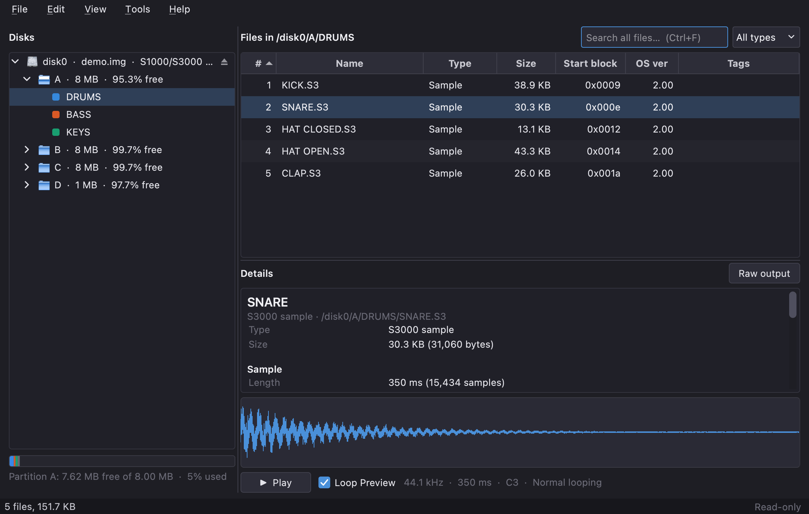
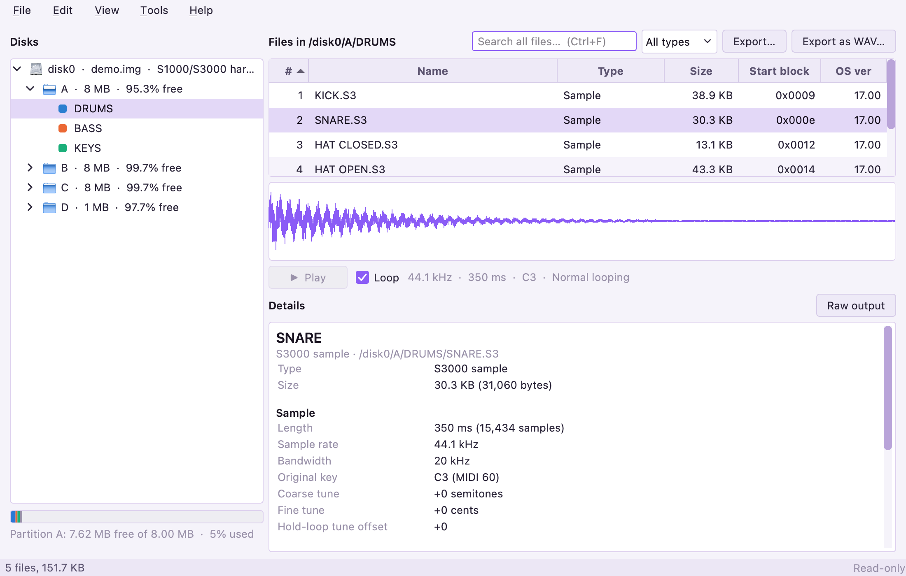
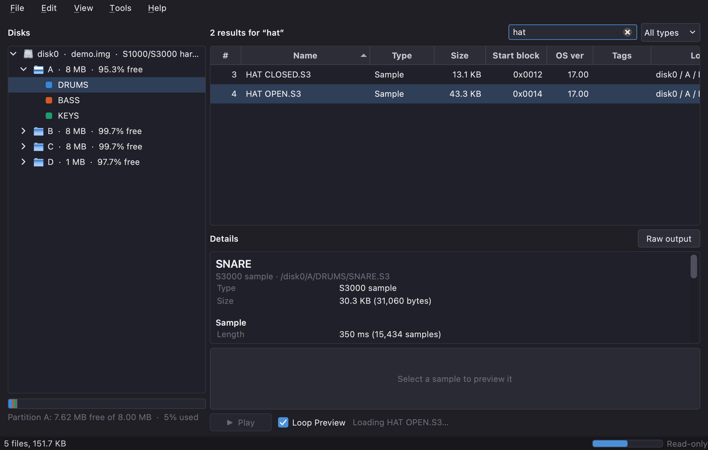
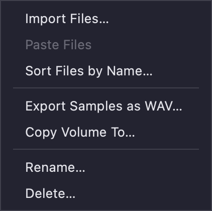
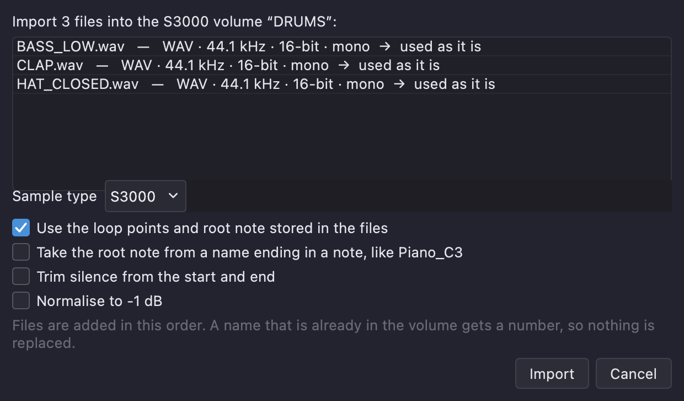
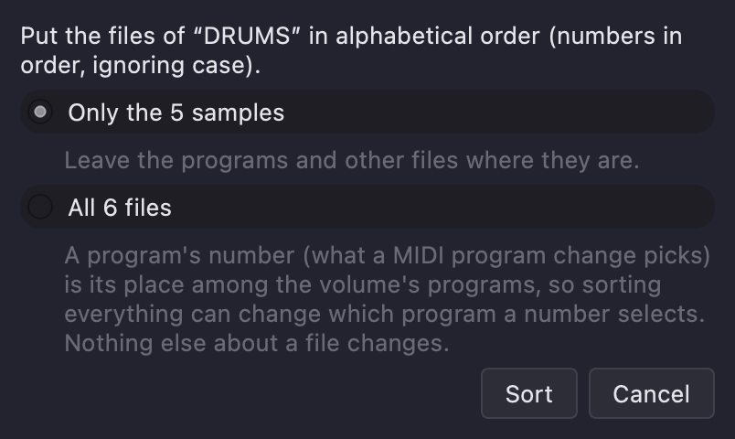
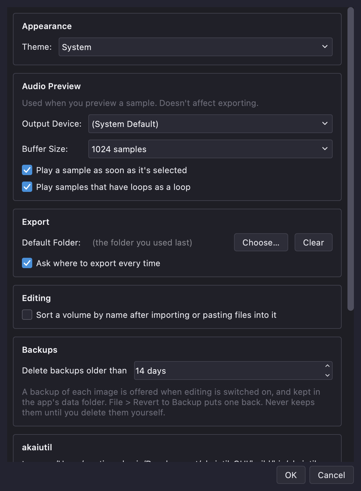

# akaiutil-GUI User Manual

akaiutil-GUI opens Akai S900, S1000 and S3000 disk images (the files you get from a Gotek, SCSI2SD or card-reader backup of
your sampler's disk) and lets you look inside them, listen to the samples, take files out, and, if you choose, change what's
inside. It does its work by running Klaus Michael Indlekofer's **akaiutil** program for you.

---

## Contents

- [Getting started](#getting-started)
- [The main window](#the-main-window)
- [Opening disk images](#opening-disk-images)
- [Looking around](#looking-around)
- [Searching](#searching)
- [Listening to samples](#listening-to-samples)
- [Taking files out](#taking-files-out)
- [Editing disk images](#editing-disk-images)
- [Renaming, deleting and new volumes](#renaming-deleting-and-new-volumes)
- [Importing samples](#importing-samples)
- [Copying and moving files](#copying-and-moving-files)
- [Sorting a volume](#sorting-a-volume)
- [New disk images and formatting](#new-disk-images-and-formatting)
- [Several disks at once](#several-disks-at-once)
- [Settings](#settings)
- [Keyboard shortcuts](#keyboard-shortcuts)
- [Troubleshooting](#troubleshooting)
- [Good to know](#good-to-know)

---

## Getting started

1. **Open an image.** Choose **File > Open Disk Image…**, or drag the image file onto the window. (The start screen has buttons for this, and for **New Disk Image…** if you want to make an empty one.)
2. The first time, the app needs akaiutil. If it isn't installed it offers to download it (the download is checked against a
   known checksum) or lets you point at a copy you already have. Built apps include akaiutil, so this only happens when running
   from source.
3. Click around. Nothing you do in the browsing views can change the image: **every image opens read-only**. Changing things
   is something you switch on deliberately (see [Editing disk images](#editing-disk-images)).

---

## The main window

- **Disks** (left): every open disk, its partitions, and the volumes in them. The coloured bar under the tree shows how full
  the selected disk or partition is, split by volume (each volume has the same colour in the tree and in the bar).
- **Files** (top right): the files in the selected volume, or search results. Click a column heading to sort the list on screen.
- **Preview** (middle right): appears when you select a single sample.
- **Details** (bottom right): everything akaiutil knows about the selected disk, partition, volume or file, written out in plain
  words. **Raw output** shows exactly what akaiutil printed.
- **Status bar:** messages, and on the right **Read-only** or **Editing** (see below).

**View > Theme** switches between System, Light and Dark. **View > Console** shows the conversation with akaiutil, which is
useful if something misbehaves.

---

## Opening disk images

| Do this | To |
|---|---|
| **File > Open Disk Image…** (Ctrl/Cmd+O) | Open one or more images, replacing what's open |
| **File > Add Disk Image…** (Ctrl/Cmd+Shift+O), or drop files on the window | Add images to the ones already open |
| Right-click a disk > **Close Disk Image** (Ctrl/Cmd+Shift+W) | Close one image and keep the others |
| **File > Close All Images** (Ctrl/Cmd+W) | Close everything |
| Right-click a disk > **Reveal in Finder** (or Show in Explorer) | See the image file |

Each disk row shows which file it came from. Hard-disk images show their partitions (A, B, C…) and each partition's volumes.
Floppy images hold a single volume.

Opening or closing a single image restarts akaiutil on the new set of images, which can take a moment with several large
images. The disks are numbered in the order they were opened, so closing one in the middle renumbers the rest. What you had
selected, and whether editing is on, carry over.

---

## Looking around

Select a disk, partition, volume or file and the **Details** pane describes it. For a sample that means its length, sample
rate, root key, tuning, play mode, markers and loops; for a volume, its number of files, load number and space used.

The list of files shows each file's number (its slot in the volume, which is the order a sampler lists them in), name, type,
size, start block, OS version and tags. A file's type is its extension, for example `.S3` for an S3000 sample, `.P3` for a
program.

Drag the edge of a column heading to change its width (double-click the edge to fit the column to its contents); the last column
takes up any spare room. **Right-click a column heading** to choose which columns are shown (the name always is), or to reset them.
Which columns are hidden and how wide each one is are remembered. Click a heading to sort by it.

**Tags** are the labels an S3000 hard disk lets you put on files (a partition has 26 tag names, "TAG A" to "TAG Z" unless
they were renamed on the sampler, and a file can carry up to four). The list shows them by name. This program shows tags but
can't set or clear them yet.

Samplers don't have folders: a volume is a flat list of files.

---

## Searching

Type in the search box (Ctrl/Cmd+F) to search **every open disk** at once. All the words you type have to match, in the file's
name or the name of the volume it's in. The type menu next to it narrows the search to samples, programs or other files, and you
can leave the box empty and pick a type to browse everything of that kind.

Results show where each file lives. Double-click a result (or press Enter) to jump to it in its volume. You can preview, export,
rename, copy and delete results just as you can in a volume. Press Escape, or clear the box, to go back.

The search covers files the app has finished indexing; a message says so if you search before it's done.

---

## Listening to samples

Select a single sample and its waveform appears under the Details, with a **Play** button (the details shrink to make room).
Press **Space** to play and stop, or click the waveform to play from that point.

- If the sample has loops (and its play mode loops), tick **Loop Preview** to hear the attack once and then the loop repeating, until
  you stop it if its loop time is Hold. Untick it to hear the sample play once. S900 samples play once.
- The preview plays through your computer's default output. **Settings** lets you pick another device, change the buffer size
  (raise it if you hear clicks), and have samples play as soon as you select them.

The preview uses the same audio engine as AKAISDS.

---

## Taking files out

Select files and use **File > Export…** (Ctrl/Cmd+E) to copy them out of the image exactly as Akai stores them, or
**File > Export as WAV…** (Ctrl/Cmd+Shift+E) to convert samples to WAV files. A WAV exported this way carries the sample's root
note and loop points in the standard `smpl` chunk, so a DAW or sample editor sees them, and also the sampler's own settings in an
extra chunk, so importing it back into this program restores everything. (Loops are only written if the sample's play mode loops.
The sample's tuning offset isn't in the `smpl` chunk.)

To take out a whole volume, partition or disk, right-click it in the tree and choose **Export Samples as WAV…**. Each volume gets
a folder named after it (`A - DRUMS`) inside the folder you pick. Programs and other non-sample files aren't included.

If you export files from several volumes at once, each volume gets its own folder so same-named files can't overwrite each other.
If a file already exists in the folder you're asked whether to replace it (with Replace All and Skip All for big batches).
**Settings** can set a default export folder and stop it asking where to export each time.

You can also **drag files out of the list** onto the desktop, a Finder or Explorer window, or your DAW. Samples arrive as WAV
files; hold **Option** (Alt on Windows and Linux) when you start the drag to get them exactly as Akai stores them instead.
Programs and other non-sample files are always written as they are.

---

## Editing disk images

> **Editing changes the image file itself, immediately, with no undo.** That is why the app offers to back the image up first
> (see [Backups and reverting](#backups-and-reverting) below).

Choose **Edit > Allow Editing** (or just ask for a change, such as a rename; the app asks first). It restarts akaiutil in
read/write mode on the open images, and the status bar shows **Editing**, highlighted. Every change from then on is written to the
image at once. Opening images again puts the app back in read-only mode (adding or closing an image keeps editing on, unless a
file you add can't be written to).

Editing is on for **all** the open images together, not one at a time. If an image file is read-only on your computer, the app
tells you which one and stays read-only: change its permissions, or work on a copy.

Everything in the next sections needs editing to be on, and asks to switch it on if it isn't.

### Backups and reverting

The first time you switch editing on, the app asks whether to **Back Up and Edit**, or **Edit Without Backup** (or Cancel;
**Show Details…** lists the images and their sizes). A backup is a full copy of each open image (a hard disk image can be hundreds of MB; on a Mac with APFS the copy is
instant and takes no extra space). It is kept in the app's own data folder, not next to your image, so it can't be mistaken for
a disk you opened. The app asks once per image per session: switch editing off and on again and it doesn't ask again, and an
image you add while editing is on gets its own question. A brand-new image from **File > New Disk Image…** has nothing to lose,
so it isn't asked about.

To go back, choose **File > Revert to Backup…**, pick one of the backups (newest first, with its date and size) and confirm.
The image file is replaced by the backup, and the image as it was just before is backed up first, so even a revert can be undone
the same way. The images then open again read-only. The newest 5 backups of each image are kept; older ones are deleted
automatically. If there isn't room for a backup, the app says so and editing stays off.

---

## Renaming, deleting and new volumes

Right-clicking a volume, a disk or some files shows what you can do with it:

- **Rename** (F2, or right-click > Rename…): a volume or a file. A file's type (`.S3`, `.P3`…) can't be changed, only the name
  before it. Akai names are up to 12 characters (10 on an S900) of capital letters, digits, space and `#` `+` `-` `.`. The
  rename box capitalises as you type, leaves out characters Akai can't store (and tells you which), and stops at the limit.
- **Delete** (Delete key, or right-click > Delete…): files, or a whole volume with everything in it. It always asks first.
- **New volume** (Edit > New Volume…, or right-click a partition): choose a name, volume number, type (S1000, S3000 or CD3000;
  an S900 disk makes S900 volumes) and an optional load number (1 to 128, the number the sampler's front panel uses). Floppies
  hold one volume and don't offer this.

---

## Importing samples

**Drag audio files onto a volume** in the list of disks (or onto the window, to import into the selected volume), or choose
**Edit > Import Files…** (Ctrl/Cmd+I). A dialog lists every file and what will happen to it. Drop a folder to import the files in it.

What you can import:

- **Audio:** WAV, AIFF and FLAC (also OGG, MP3, CAF and W64). Anything that isn't 16-bit, or is faster than the sampler can
  play (44.1 kHz; 40 kHz for an S900), is converted first. A 16-bit WAV that needs nothing is used exactly as it is.
- **Akai files:** `KICK.S3`, programs (`.P3`), effects and so on go in unchanged, but only into a volume of the right sampler.

Choices in the dialog:

- **Sample type:** S1000, S3000 or S900 (and for an S900, whether to compress). An S900 volume only takes S900 samples and an S1000
  volume only S1000 ones; an S3000 volume takes any.
- **Stereo files:** split into a left and a right sample (named `…-L` and `-R`, as the samplers' stereo pairs are) or mixed to
  mono.
- **Use the loop points and root note stored in the files:** many DAWs and sample editors write these into a WAV (its `smpl`
  chunk). The sample is imported with its loop (held until you release the key) and root key.
- **Take the root note from a name ending in a note,** like `Piano_C3` (middle C is C3), if the file doesn't say.
- **Trim silence** from the start and end (anything quieter than −60 dB; it never cuts into a loop) and **Normalise** to −1 dB.

Files are added in **alphabetical order** (numbers in order, so `kick 2` comes before `kick 10`, ignoring case). A name that's
already in the volume gets a number (`KICK 2`): **nothing is ever replaced**. A WAV exported by this app keeps its own settings
untouched whatever you choose. Files that can't be imported (unreadable, more than two channels, the wrong sampler) are listed
afterwards; the rest still go in.

---

## Copying and moving files

- **Copy / Cut / Paste:** select files and choose **Edit > Copy Files** (Ctrl/Cmd+C) or **Cut Files** (Ctrl/Cmd+X), select a
  volume, and choose **Paste Files** (Ctrl/Cmd+V). The right-click menus have them too.
- **Drag and drop:** drag files from the list onto any volume in the disk tree, in any partition or any open disk. A plain drag
  **copies**; hold **Shift** (Cmd on a Mac) to **move** instead. If your system doesn't do what you expect, Cut and Paste always
  means move.

A move inside one partition changes nothing about the file but where it lives. A copy, or a move to another partition or disk,
reads the file out and puts it back unchanged (the original is deleted only after the copy is safely there). An S3000 file
**keeps its tags**; another partition may name its tags differently, so a tag is matched by its *name*, and you are told about
any tag the target doesn't have. A name that already exists in the target gets a number, and files of the wrong sampler for the
target volume are refused, as for importing.

### Copying a whole volume

Right-click a volume and choose **Copy Volume To…** to copy it, with every file in it, into a hard disk partition: another
partition of the same disk, or one on any other open disk. Pick the partition and a name for the copy; the name starts out as
the original's, with COPY added if the partition already has one. The dialog tells you if the partition hasn't got room.

The copy keeps the volume's settings and each file's OS version and tags. It does **not** take over a load number that another
volume in the partition already uses (the samplers would have two volumes answering to one number): the copy gets none, and you
are told. Tags are copied by number, so if the other partition names its tags differently you are told that as well. If a copy
can't be finished, what was started is removed again, so no half-copied volume is left behind. An S900 volume only goes to an S900
hard disk, and the other kinds only to the other hard disks.

### Changing a sample's settings

Select one S1000 or S3000 sample and choose **Edit > Sample Settings…** (or right-click it). The dialog shows and changes:

- **Root key** (shown as a note name, middle C being C3), **tuning** in semitones and **fine tuning** in cents (each up to 50
  either way).
- **Play mode:** normal looping, loop until release, no looping, or play to the sample's end.
- **Start and end markers** (the first and last frame that plays).
- **Up to 8 loops:** switch each on, give its start and end frames, and either a time in milliseconds or **Hold** (until the key
  is released).

The sample's waveform sits at the top of the dialog with the markers on it: the **start and end markers** in grey (the part
outside them is dimmed) and each loop's **in and out markers** in the colour of that loop's number in the list below.

- **Drag a marker** to move it, and the numbers follow. Hold **Shift** while dragging for fine control. A marker dragged past its
  partner pushes it along, so a loop or the start/end pair can never end up backwards. A marker can be grabbed anywhere along its
  line. Where the sample's start or end and a loop's marker overlap, the height decides: the **top half** takes the sample's
  marker and the **bottom half** the loop's (each has its little handle on that side). Where several loop markers sit on top of one
  another, clicking again takes the next one.
- **Zoom** with Ctrl (Cmd on a Mac) + scroll, a trackpad pinch, or the **+** / **−** buttons (**Fit** shows the whole sample),
  and **pan** with Shift + scroll, a sideways swipe or the scroll bar that appears under the waveform. Zoom right in to put a
  marker on an exact frame.
- **Click the waveform** (away from the markers) to hear the sample as it is set in the dialog: from the start
  marker, through the selected loop (the one whose marker you last touched, otherwise the first that is on) for its time or until
  you click again if it is on Hold, then to the end marker. Click again at any time to stop. While a loop plays, moving its markers changes it at its next pass,
  so edits can be heard as you make them. The preview plays at the sample's original pitch; root key and tuning aren't applied.

**Save** is only available when the settings make sense (a start before its end, everything inside the sample). The audio itself
is never changed.

The samplers can't edit a header in place, and neither can akaiutil, so the app writes the sample again with the new settings and
puts it back in the same place: same name, same slot in the volume, same tags and OS version. The old copy is deleted only after
the new one has been checked, and if anything goes wrong the old one is put back and nothing changes. Still, **this changes the
sample inside the image and can't be undone** except from a backup. S900 samples aren't supported (their headers are different).

---

## Sorting a volume

A sampler lists a volume's files in the order they were added, and has no way to sort them. **Edit > Sort Files by Name…** (or
right-click a volume) puts them in alphabetical order, ignoring case and with numbers in order. It moves files between slots; the
files themselves aren't touched.

A **program's number** (what a MIDI program change selects) is its place among the volume's programs. So the dialog lets you
sort **only the samples** and leave programs and other files exactly where they are, which is the safe choice and the default when
a volume has programs, or sort **everything**, which can change which program a number picks. Multis refer to their programs by
name, so they aren't affected.

**Settings > Editing** can do this automatically after every import or paste (samples only if there are other files).

A volume with every slot in use (510 files, or 64 on an S900) has no room to shuffle files and can't be sorted.

---

## New disk images and formatting

- **File > New Disk Image…** makes a new, empty, formatted image file and opens it next to the others. Choose the kind:
  an S3000, S1000 or CD3000 hard disk (1 to 512 MB, split into partitions of up to 60 MB), an S900 hard disk (up to 64 MB), or
  a floppy (S900, S1000 or S3000, DD at 800 KB or HD at 1.6 MB).
- **Format Disk…** (right-click a disk, or Edit > Format Disk…) **erases everything** on a disk and sets it up as an empty one of
  the kind you choose. A floppy keeps its size, so only formats of the same density are offered. It tells you how many files
  and volumes will be lost, and asks first.

---

## Several disks at once

Open as many images as you like. They all appear in the disk tree, search covers all of them, and you can copy and move files
between them. Because all the images share one akaiutil session, **Allow Editing** applies to all of them at once.

---

## Settings

Open **Settings** (File > Settings…, or Cmd+, on a Mac).

- **Appearance:** System, Light or Dark.
- **Audio Preview:** output device, buffer size, whether samples play when selected, and whether samples with loops play as a loop.
- **Export:** a default folder, and whether to ask each time.
- **Editing:** sort a volume after importing or pasting.
- **akaiutil:** which akaiutil to use (**Locate…**, or **Use Default** for the one that came with the app).
- **Updates:** check when the app starts (at most once a day). **Help > Check for Updates…** checks right now. The app only tells
  you a new version exists and links to its download page; it installs nothing itself.

---

## Keyboard shortcuts

On a Mac use Cmd where this says Ctrl.

| Keys | Does |
|---|---|
| Ctrl+O | Open disk images |
| Ctrl+Shift+O | Add disk images |
| Ctrl+N | New disk image |
| Ctrl+W / Ctrl+Shift+W | Close all images / close the selected disk |
| Ctrl+E / Ctrl+Shift+E | Export / Export as WAV |
| Ctrl+F, Esc | Search all files, clear the search |
| Space | Play or stop the selected sample |
| F2 | Rename the selected file or volume |
| Delete | Delete the selected files or volume |
| Ctrl+C / Ctrl+X / Ctrl+V | Copy / Cut / Paste files |
| Ctrl+I | Import files into the selected volume |
| Ctrl+J | Show or hide the akaiutil console |
| F1 (Cmd+? on a Mac) | This manual |

---

## Troubleshooting

**"Set up akaiutil" appears.** The app couldn't find akaiutil. Choose **Download and set up**, or **Locate existing…** if you
already have it. **Tools > Locate akaiutil…** changes it later.

**An image won't open, or shows "no Akai filesystem found".** The file isn't an Akai disk image akaiutil understands, or it hasn't
been formatted. A blank image can be formatted with **Format Disk…**. **View > Console** shows what akaiutil said.

**The backups take a lot of room.** Each backup is a full copy of an image. They are deleted automatically when the app starts, once
they are older than **Settings > Backups > Delete backups older than** (14 days to begin with; the newest 5 of each image are kept
at most), and you can set that to a shorter time. The folder is `backups` in the app's data folder.

**Editing won't switch on.** The image file is read-only on your computer. The message names the file: change its permissions or
work on a copy.

**Preview is silent or clicks.** Check **Settings > Audio Preview**: pick the right output device, and raise the buffer size if it
clicks. Samples whose play mode doesn't loop play once even with Loop Preview ticked.

**A file can't be imported or pasted.** The message after the import lists each file and why. The usual reasons are a file that
isn't audio, more than two channels, or a sample for the wrong sampler (an S3000 sample can't go into an S900 volume).

**Dragging files out of the list does nothing in some app.** Use **File > Export…** instead.

**Something looks wrong.** **View > Console** shows exactly what the app and akaiutil said to each other.

### Reporting a problem

The app keeps a log of what it did and every error. To report a problem, attach the log:

1. If you can repeat the problem, turn on **Settings > Troubleshooting > Log every command sent to akaiutil**, then repeat it.
2. Choose **Help > Show Log File**. It opens the folder with `akaiutil-gui.log` (and `crash.log`, if the program ever closed
   unexpectedly), with the log selected.
3. Send those files with a short description of what you did and what you expected.

The log holds the app's version, your operating system, the images you opened and the files you changed, and any error with
details. It contains file paths and Akai file names, but never audio. It is limited in size, so older entries drop off.

---

## Good to know

- **No undo,** and changes are written at once. Say yes to the backup when editing is switched on, and use **File > Revert to Backup…** to go back.
- A sample's loops, root key, tuning, play mode and markers can be changed with **Edit > Sample Settings…** (S1000 and S3000 samples only).
- S900 samples are previewed as one-shots, and get no loops on import.
- Direct-to-disk recordings (takes) are listed as text only.
- Adding or closing a disk image restarts akaiutil, so disk numbers can change and the search index is rebuilt.
- The app is built on [akaiutil](https://sourceforge.net/projects/akaiutil/) by Klaus Michael Indlekofer (GPL v2 or later).
  **Help > About** has the licences.
