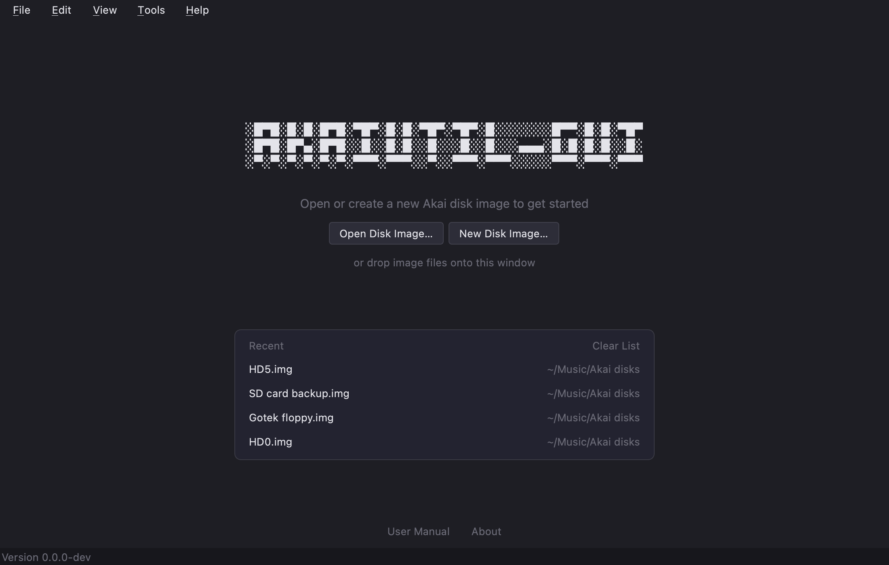
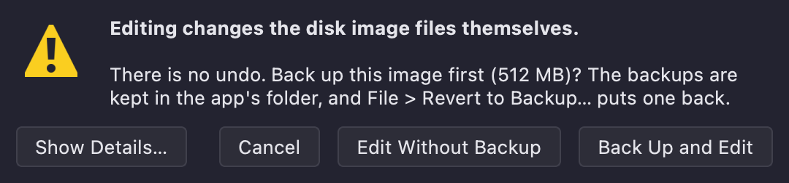
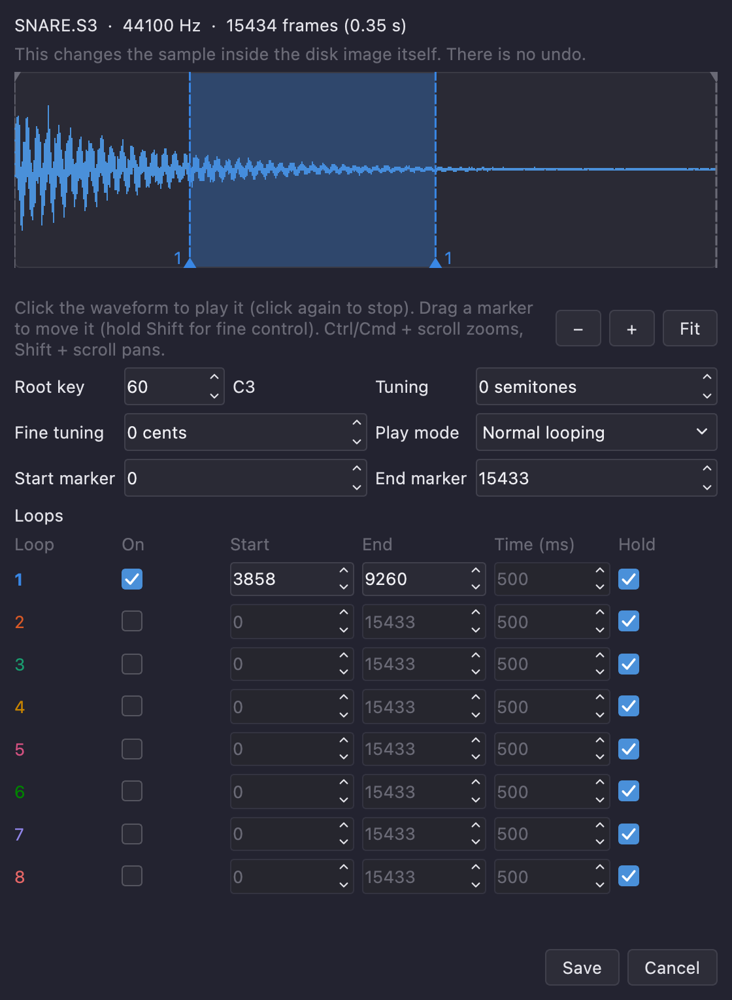

# akaiutil-GUI User Manual

akaiutil-GUI allows you to open, view and edit Akai S900, S1000 and S3000 disk images. It is powered by Klaus Michael Indlekofer's **akaiutil** program.

---

## Contents

- [Getting started](#getting-started)
- [The main window](#the-main-window)
- [Opening disk images](#opening-disk-images)
- [Looking around](#looking-around)
- [Searching](#searching)
- [Listening to samples](#listening-to-samples)
- [Taking files out](#taking-files-out)
- [Editing disk images](#editing-disk-images)
- [Renaming, deleting and new volumes](#renaming-deleting-and-new-volumes)
- [Importing samples](#importing-samples)
- [Copying and moving files](#copying-and-moving-files)
- [Changing a sample's settings](#changing-a-samples-settings)
- [Sorting a volume](#sorting-a-volume)
- [New disk images and formatting](#new-disk-images-and-formatting)
- [Several disks at once](#several-disks-at-once)
- [Settings](#settings)
- [Keyboard shortcuts](#keyboard-shortcuts)
- [Troubleshooting](#troubleshooting)
- [Good to know](#good-to-know)

---

## Getting started

1. **Open an image.** Choose **File > Open Disk Image…**, or drag the image file onto the window. Files that are plainly not disk images (a PDF, a picture, a text file, anything smaller than a floppy) are turned away with a message instead of being opened. If a file gets past that but akaiutil finds no Akai disk in it, it is closed again with a message too (a blank image waiting to be formatted is fine).
2. Click around. **Every image opens read-only by default**. If you want to edit the image, the app will ask if you want to create a backup first (see [Editing disk images](#editing-disk-images)).

---

## The main window

- **Disks** (left): every open disk, its partitions, and the volumes in them. The bar under the list shows how full the selected disk or partition is, split by volume.
- **Search** (top right): filter the files in the selected volume, or search results. Click a column heading to sort the list on screen.
- **Preview waveform**: appears when you select a sample.
- **Details**: everything akaiutil knows about the selected disk, partition, volume or file. **Raw output** shows the unformatted version.

**View > Theme** switches between System, Light and Dark. **View > Console** shows the conversation with akaiutil, which can be useful for troubleshooting.

---

## Opening disk images

| Do this | To |
| --- | --- |
| **File > Open Disk Image…** (Ctrl/Cmd+O) | Open one or more images |
| **File > Add Disk Image…** (Ctrl/Cmd+Shift+O), or drop files on the window | Add images to the ones already open |
| The **eject button** at the right of a disk, **File > Close Disk Image** (Ctrl/Cmd+Shift+W), or right-click a disk > **Close Disk Image** | Close one image and keep the others |
| **File > Close All Images** (Ctrl/Cmd+W) | Close everything |
| Right-click a disk > **Reveal in Finder** (or Show in Explorer) | See the image file |

Each disk row shows which file it came from. Hard-disk images show their partitions (A, B, C…) and each partition's volumes.
Floppy images hold a single volume.

Opening or closing an image restarts akaiutil, which can take a moment with several large images.

### HFE images (Gotek and HxC emulators)

An **`.hfe`** file is a floppy as a Gotek or HxC floppy emulator plays it. akaiutil can't read that format, so the app opens it for you in a different way: it reads the sectors out of the file into a working copy, and akaiutil works on that. You open, browse and edit it like any other image, and the disk shows under the `.hfe` file's name.

- **Edits are written back into the `.hfe` file after each change,** just as they are for an ordinary image. Only the sectors that changed are touched, and the rest of the file stays exactly as it was. If the file can't be written (a read-only card, a full disk) the app says so, keeps your change in the working copy, and tries again after the next change or when you close the image.
- **The backup** that editing offers is a copy of the `.hfe` file, and **File > Revert to Backup…** puts it back.
- **File > Save Disk as HFE…** saves the selected floppy as an `.hfe` file: an HFE image under a new name, or an ordinary floppy image (800 KB or 1.6 MB) as an HFE.
- **Damaged files** (a few sectors whose checksum doesn't match, usually read errors from when the disk was copied) open **read-only**, with a warning that names the sectors. Those sectors show as blank, so a file stored there will be missing or wrong. Editing is off while one is open, and **Save Disk as HFE…** refuses it, so the blanks never get written into a file.
- Only the format Akai disks use is understood: HFE version 1, MFM, 80 tracks on two sides. A file in HFE version 3 is turned away with the reason.

---

## Looking around

Select a disk, partition, volume or file. The **Details** pane describes the selection. For a sample that means its length, sample rate, root key, tuning, play mode, markers and loops; for a program, its keygroups, each with its key range, tuning, filter and
the sample played in each velocity zone; for a volume, its number of files, load number and space used.

The list of files shows each file's number (its slot in the volume, which is the order a sampler lists them in), name, type, size, start block, OS version and tags. A file's type is its extension, for example `.S3` for an S3000 sample, `.P3` for an S3000 program. The OS version is the one the sampler's own screen shows (OS 2.00, say). akaiutil prints S3000-series versions 15 higher (`17.00`), so you will see that number if you compare with its output; the volume's details show both.

**Right-click a column heading** to choose which columns are shown or to reset them. Click a heading to sort by it.

**Programs and samples.** A program plays samples by name, from the same volume. Multis aren't shown in the **Details** view yet.

---

## Searching

Type in the search box (Ctrl/Cmd+F) to search **every open disk** at once. The type menu next to it narrows the search to samples, programs or other files.

Results show where each file lives. Double-click a result (or press Enter) to jump to it in its location. You can preview, export, rename, copy and delete results just as you can in a volume. Press Escape, or clear the box, to go back.

Results are indexed. If you try to search before indexing is complete, only the indexed results will appear and the app will let you know that indexing is still happening in the background.

---

## Listening to samples

Click on a single sample and its waveform appears under the Details section. By default, the sample will play as soon as you click on it. Press **Space** to play and stop, or click anywhere on the waveform to play from that point.

- If the sample has loop points set, check **Loop Preview** to hear it. Uncheck it to hear the sample play once through to the end. **Loop Preview** is not currently supported for S900 samples.
- The preview plays through your computer's default output. **Settings** lets you pick another device, change the buffer size, and choose whether samples play as soon as you click them.

The preview uses the same audio engine as [AKAISDS](https://github.com/martincurkovic/AKAISDS).

---

## Taking files out

Select files and use **File > Export…** (Ctrl/Cmd+E) to copy them out of the image exactly as Akai stores them, or **File > Export as WAV…** (Ctrl/Cmd+Shift+E) to convert samples to WAV files. A WAV exported this way saves the sample's root note and loop points in the output file, so a DAW or sample editor can see them too.

To export a whole volume, partition or disk, right-click it in the tree and choose **Export Samples as WAV…**. Each volume gets a folder named after it (e.g., `A - DRUMS`) inside the folder you pick. Program files and other non-sample files aren't included.

If you export files from several volumes at once, each volume gets its own folder so same-named files can't overwrite each other. If a file already exists in the folder you're asked whether to replace it. **Settings** lets you set a default export folder.

You can also **drag files out of the list** onto the desktop, a Finder or Explorer window, or your DAW. Samples are exported as WAV files; hold **Option** (Alt on Windows and Linux) when you start the drag to export them exactly as Akai format sample files.

---

## Editing disk images

> **Editing changes the image file itself, immediately, with no undo.** That's why the app offers to back the image up first (see [Backups and reverting](#backups-and-reverting) below).

Choose **Edit > Allow Editing** (or just start editing; the app asks first). It restarts akaiutil in
read/write mode on the open images, and the status bar shows **Editing**, highlighted. Every change from then on is written to the image immediately.

Editing is on for **all** the open images simultaneously, not one at a time. If an image file is read-only on your computer, the app tells you which one cannot be written to and stays in read-only mode.

Everything in the next sections needs editing to be on, and asks to switch it on if it isn't.

### Backups and reverting

The first time you switch editing on, the app asks whether to **Back Up and Edit**, or **Edit Without Backup** (**Show Details…** lists the images and their sizes). A backup is a full copy of each open image (on a Mac with APFS the copy is instant and takes no extra space). The backup is kept in the app's own data folder. The app asks once per image per session.

To go back, choose **File > Revert to Backup…**, pick one of the backups (newest first, with its date and size) and confirm. The image file is replaced by the backup. The 5 most recent backups of each image are kept; older ones are deleted automatically.

---

## Renaming, deleting and new volumes

Right-clicking a volume, a disk or some files shows what you can do with it:

- **Rename** (F2, or right-click > Rename…): a volume or a file.
- **Delete** (Delete key, or right-click > Delete…): files, or a whole volume with everything in it. It always confirms before deleting.
- **New volume** (Edit > New Volume…, or right-click a partition): choose a name, volume number, type (S1000, S3000, CD3000 or S900) and an optional load number (1 to 128, the number the sampler's front panel uses). Floppies can only hold one volume.

---

## Importing samples

**Drag audio files** onto a volume or the window, or choose **Edit > Import Files…** (Ctrl/Cmd+I). A dialog lists every file and what will happen to it. Drop a folder to import the files in it.

What you can import:

- **Audio:** WAV, AIFF, FLAC, OGG, MP3, CAF and W64 are all supported. M4A, AAC, WMA and similar aren't: convert them to WAV, AIFF or FLAC first. Anything that isn't 16-bit, or is above the maximum sample rate (40 kHz for an S900, 44.1 kHz for all other samplers), is converted first.
- **Akai files:** `KICK.S3`, programs (`.P3`), effects and so on go in unchanged. A file made for a different sampler than the volume's (an S3000 sample in an S1000 volume, say) is marked as skipped until you tick **Add anyway**; see *Files for another sampler* below.
- **Anything else with an Akai file type in its name**, such as an operating system image (`.C`, `.C3`). The app can't check these, so the dialog marks them as skipped until you tick **Add anyway**. They then go in exactly as they are, as the type the extension says. The choice isn't remembered. Choose **Operating system images** in the file picker's list of file types, or **All files**.
- **Any other file**, such as a text file or a PDF. Tick **Add anyway** and it is stored as it is, with its whole name kept and `.X01` added after it (a sampler's file types are a single byte, and akaiutil takes it from the end of the name), so `Patch notes.txt` becomes `PATCH NO.TXT.x01`. The app can't tell what a sampler will make of a file like that.

**Where to drop files.** Drop them on a volume in the list of disks and everything goes into that volume, through the dialog above. Dropped on the rest of the window, audio and Akai files go into the selected volume, a disk image is opened, and anything else is turned away with a message.

Choices in the dialog:

- **Sample type:** S1000, S3000 or S900 (and for an S900, whether to compress). Audio is converted to the volume's own kind: an S900 volume gets S900 samples, an S1000 volume S1000 ones, and an S3000 volume any of the three.
- **Stereo files:** split into a left and a right sample (named `…-L` and `…-R`) or mixed to mono.
- **Use the loop points and root note stored in the files:** many DAWs and sample editors write these into a WAV. The sample is imported with its loop and root key.
- **Take the root note from a name ending in a note,** like `Piano_C3`.
- **Trim silence** from the start and end (anything quieter than −60 dB unless it's part of a loop) and **Normalise** to −1 dB.

Files are added in **alphabetical order**. A name that's already in the volume gets a number (`KICK 2`): **nothing is ever replaced**. Files that can't be imported (e.g., corrupted files) are listed afterwards.

---

## Copying and moving files

- **Copy / Cut / Paste:** select files and choose **Edit > Copy Files** (Ctrl/Cmd+C) or **Cut Files** (Ctrl/Cmd+X), select a volume, and choose **Paste Files** (Ctrl/Cmd+V).
- **Drag and drop:** drag files from the list onto any volume in the disk tree, in any partition or any open disk. A plain drag **copies**; hold **Shift** (Cmd on a Mac) to **move** instead.

### Files for another sampler

Pasting or dropping a file that was made for a different sampler than the volume's (an S3000 sample in an S1000 or S900 volume, or an S900 sample in an S1000 volume) shows a question first, listing the files: **Add Anyway** copies them, **Skip** leaves them out and carries on with the rest, and Cancel stops. Skipped files are named in the message afterwards. Importing Akai files from your computer has the same choice, as the **Add anyway** tick box in the import dialog.

Some people keep S1000 or S900 disk images for their S3000-series sampler and write `.S3` files to them, and that is what this is for. A few things to know:

- The file's contents are copied untouched, but its OS version isn't kept. akaiutil gives it the volume's (an S3000 sample in an S1000 volume shows `4.40`; an S900 volume has no OS version at all).
- The app can't tell whether your sampler will list the file. A sampler only knows the kinds of file its own generation made, so check on the sampler.
- Tags aren't carried between volumes of different kinds, and only S3000 and CD3000 volumes have them.
- A compressed S900 sample (`.S9C`) can't be added anyway outside an S900 volume: akaiutil writes a wrong OS version for it, and the file would come out wrong.

### Copying a whole volume

Right-click a volume and choose **Copy Volume To…** to copy it into a hard disk partition. Pick the partition and a name for the copy. The dialog tells you if the partition hasn't got enough free space.

---

## Changing a sample's settings

Select an S1000 or S3000 sample and choose **Edit > Sample Settings…** (or right-click it).

The dialog shows and changes:

- **Root key**, **tuning** in semitones and **fine tuning** in cents.
- **Play mode:** normal looping, loop until release, no looping, or play to the sample's end.
- **Start and end markers**.
- **Up to 8 loops:** switch each on, give its start and end frames, and either a time in milliseconds or **Hold** (until the key is released). Note that S2000 samplers can only read the first loop.

The sample's waveform is shown with markers on it: the **start and end markers** in grey, and each loop's **in and out markers** in the colour of that loop's number in the list below.

- **Drag a marker** to move it. Hold **Shift** while dragging for fine control.
- **Zoom** with Ctrl (Cmd on a Mac) + scroll, a trackpad pinch, or the **+** / **−** buttons (**Fit** shows the whole sample).
- **Click the waveform** to hear the sample as it is set in the dialog: from the start
  marker, through the selected loop (the one whose marker you last touched, otherwise the first that is on). Click again to stop. The preview plays at the sample's original pitch; root key and tuning aren't applied.

S900 samples aren't supported in the edit window (their header info is different).

---

## Sorting a volume

A sampler lists a volume's files in the order they were added, and has no way to sort them. **Edit > Sort Files by Name…** (or right-click a volume) puts them in alphabetical order.

A **program's number** (what a MIDI program change selects) is its place among the volume's programs. So the dialog lets you sort **only the samples** and leave programs and other files exactly where they are, which is the safe choice and the default when a volume has programs, or sort **everything**, which *may* change which program a number picks. Multis refer to their programs by name, so they aren't affected.

**Settings > Editing** can do this automatically after every import or paste.

A volume with every slot in use (510 files, or 64 on an S900) has no room to shuffle files and can't be sorted.

---

## New disk images and formatting

- **File > New Disk Image…** makes a new, empty, formatted image file and opens it next to the others. Choose the kind: an S3000, S1000 or CD3000 hard disk (up to 512 MB, split into partitions of up to 60 MB), an S900 hard disk (up to 64 MB), or a floppy (S900, S1000 or S3000, DD at 800 KB or HD at 1.6 MB).
- **Format Disk…** (right-click a disk, or Edit > Format Disk…) **erases everything** on a disk and sets it up as an empty one of the kind you choose. A floppy keeps its size, so only formats of the same density are offered. It tells you how many files and volumes will be lost, and asks before proceeding.

---

## Several disks at once

Open as many images as you like. They all appear in the disk tree, search covers all of them, and you can copy and move files between them. Because all the images share one akaiutil session, **Allow Editing** applies to all of them at once.

---

## Settings

Open **Settings** (File > Settings…, or Ctrl/Cmd+,).

- **Appearance:** System, Light or Dark.
- **Audio Preview:** output device, buffer size, whether samples play when selected, and whether samples with loops play as a loop.
- **Export:** a default folder, and whether to ask each time.
- **Editing:** sort a volume after importing or pasting.
- **Backups:** how long to keep the backups made when editing is switched on (14 days by default; **Never** keeps all backups until you delete them yourself). At most the newest 5 backups of each image are kept.
- **Troubleshooting:** **Log every command sent to akaiutil** (makes the log bigger, but shows exactly what the app asked akaiutil to do). Turn it on before repeating a problem you want to report. **Show Log File** opens the folder where logs are stored.
- **akaiutil:** which akaiutil to use (**Locate…**, or **Use Default** for the one that came with the app).
- **Updates:** check when the app starts (at most once a day). **Help > Check for Updates…** checks right now.

---

## Keyboard shortcuts

On a Mac use Cmd where this says Ctrl.

| Keys | Does |
| --- | --- |
| Ctrl+O | Open disk images |
| Ctrl+Shift+O | Add disk images |
| Ctrl+N | New disk image |
| Ctrl+W / Ctrl+Shift+W | Close all images / close the selected disk |
| Ctrl+E / Ctrl+Shift+E | Export / Export as WAV |
| Ctrl+F, Esc | Search all files, clear the search |
| Space | Play or stop the selected sample |
| F2 | Rename the selected file or volume |
| Delete | Delete the selected files or volume |
| Ctrl+C / Ctrl+X / Ctrl+V | Copy / Cut / Paste files |
| Ctrl+I | Import files into the selected volume |
| Ctrl+J | Show or hide the akaiutil console |
| Ctrl+, | Open Settings |
| F1 (Cmd+? on a Mac) | This manual |

---

## Troubleshooting

**"Set up akaiutil" appears.** The app couldn't find akaiutil. Choose **Download and set up**, or **Locate existing…** if you already have it. **Tools > Locate akaiutil…** changes it later.

**An image won't open, or shows "no Akai filesystem found".** The file isn't an Akai disk image akaiutil understands, or it hasn't been formatted. A blank image can be formatted with **Format Disk…**. **View > Console** shows what akaiutil said.

**The backups take a lot of room.** Each backup is a full copy of an image. They are deleted automatically when the app starts, once they are older than **Settings > Backups > Delete backups older than** (14 days by default), and at most the 5 most recent backups of each image are kept.

**Editing won't switch on.** The image file is read-only on your computer. The message names the file. You can either change its permissions or work on a copy.

**Samples start playing as soon as I select them.** That is on by default. Uncheck **Settings > Audio Preview > Play a sample as soon as it's selected** to have them wait for **Play** (or Space).

**Preview is silent or clicks.** Check **Settings > Audio Preview**: pick the right output device, and raise the buffer size if it clicks. Samples that don't have a loop set, or whose play mode isn't set to loop, will only play once even with Loop Preview checked.

**A file can't be imported or pasted.** The message after the import lists each file and why. The usual reasons are a file that isn't audio (an Akai file the app can't check can be imported with **Add anyway**), a file with more than two channels, or a file for a different sampler than the volume's (an S3000 sample in an S900 volume). Those can be added anyway, apart from compressed S900 samples (see *Files for another sampler*).

**Dragging files out of the list does nothing.** Use **File > Export…** instead.

**Something looks wrong.** **View > Console** shows exactly what the app and akaiutil said to each other.

### Reporting a problem

The app keeps a log of what it did and every error. To report a problem, attach the log:

1. If you can repeat the problem, turn on **Settings > Troubleshooting > Log every command sent to akaiutil**, then repeat it.
2. Choose **Help > Show Log File**. It opens the folder with `akaiutil-gui.log` (and `crash.log`, if the program ever closed unexpectedly).
3. Send those files with a short description of what you did and what you expected.

The log holds the app's version, your operating system, the images you opened and the files you changed, and any error with details. It contains file paths and Akai file names, but never any audio. It is limited in size, so older logs are deleted automatically.

---

## Good to know

- **No undo,** and changes are written at once. Say yes to the backup when editing is switched on, and use **File > Revert to Backup…** to go back.
- A sample's loops, root key, tuning, play mode and markers can be changed with **Edit > Sample Settings…** (S1000 and S3000 samples only).
- S900 samples are previewed as one-shots, and get no loops on import.
- Direct-to-disk recordings (takes) are listed as text only.
- Adding or closing a disk image restarts akaiutil, so disk numbers can change and the search index is rebuilt.
- An **HFE** floppy is opened as a working copy and written back after each edit (see [HFE images](#hfe-images-gotek-and-hxc-emulators)). Written files match what HxC's own software produces for blank disks, but have not been tried on a real sampler yet.
- The app is built on [akaiutil](https://sourceforge.net/projects/akaiutil/) by Klaus Michael Indlekofer (GPL v2 or later). **Help > About** shows the licence.
